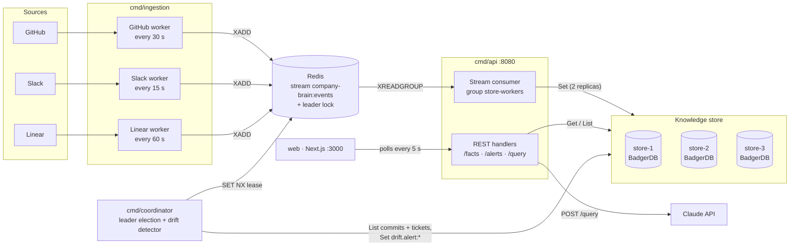
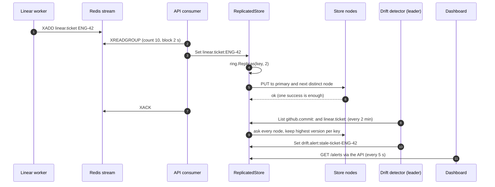

# Architecture

How Company Brain fits together, and how one event travels from a source to the dashboard. The concepts behind each piece are explained in the numbered learning docs in this folder; this page is the map.

## 1. System context

Everything runs from one `docker compose up`: Redis, three store nodes, and four Go/Next.js services.

| Part | Code | Responsible for |
|---|---|---|
| **Ingestion** | `cmd/ingestion`, `ingestion/*` | One goroutine per source. Each turns raw data into a normalised `Event` and publishes it to the stream |
| **Queue** | `queue/streams.go` | Redis Streams wrapper. At-least-once delivery: a message is acknowledged only after the handler succeeds |
| **Store nodes** | `cmd/store`, `store/badger.go`, `store/nodeserver.go` | Three independent HTTP servers, each with its own BadgerDB on disk. A node knows nothing about the others |
| **Replicated store** | `store/replication.go`, `store/partition.go` | A client-side library, not a service. It places each key on the hash ring and talks to the right nodes |
| **API** | `cmd/api`, `api/` | Runs the stream consumer **and** serves REST. It's the only writer of source facts |
| **Coordinator** | `cmd/coordinator`, `coordinator/` | Wins a Redis lease, then runs drift detection while it holds it |
| **Dashboard** | `web/` | Ingestion feed, drift alerts, and a question box. Talks to the API from the browser |

## 2. Data model

Two types carry everything (`pkg/types/types.go`):

- **`Event`**: what a worker publishes. `id`, `kind` (`github.commit`, `linear.ticket`, `slack.message`, …), `source`, `timestamp`, and a source-specific `payload`.
- **`Fact`**: what the store keeps. `key`, `value` (the event payload), `source`, `version` and `created_at`.

The consumer derives the key from the event (`store/consumer.go`), so the same commit or ticket always lands on the same key and a re-published item overwrites itself instead of piling up:

| Event kind | Fact key |
|---|---|
| `github.commit` | `github.commit:{sha}` |
| `github.pull_request` | `github.pr:{number}` |
| `linear.ticket` | `linear.ticket:{id}` |
| `slack.message` | `slack.message:{eventId}` |
| (drift detector) | `drift.alert:{alertId}` |

## 3. One event, end to end

## 4. The distributed store

**Placement.** `store/partition.go` is a consistent hash ring. Each node gets 150 virtual points (SHA-256 of `addr#i`, first 4 bytes). A key belongs to the first point clockwise from its own hash, so adding or removing a node remaps only about 1/N of keys.

**Replication.** `ReplicatedStore` writes every fact to **2 distinct nodes**: it walks clockwise from the key and skips points owned by a node it has already chosen.

| Operation | Behaviour |
|---|---|
| `Set` | Write to both replicas. Succeeds if **at least one** write succeeds |
| `Get` | Try the primary, then the replica. Return the first copy found |
| `List` | Scatter-gather: ask **every** node, skip nodes that are down, keep the highest `version` per key |
| `Delete` | Best effort on both replicas |

This favours availability over consistency. One consequence: if the primary misses an update while it's down, `Get` can return the stale copy from the primary while `List` returns the newer one.

## 5. Leader election and drift detection

Only one coordinator should raise alerts, so coordinators compete for a Redis lease (`coordinator/election.go`):

- **Acquire:** `SET company-brain:leader {node}:{token} NX EX 10s`. The token goes up each time this node wins.
- **Renew** every 4 s, but only if the stored value still matches this node and token. If not, the node steps down and its detector is cancelled.
- **Shutdown:** the leader deletes the key so another node can take over without waiting for the lease to expire.

While leading, the detector (`coordinator/drift.go`) runs every 2 minutes and checks two patterns:

| Pattern | Rule | Severity |
|---|---|---|
| Untracked commit | Commit message contains no known ticket ID | medium |
| Stale ticket | Ticket `in_progress` for 7+ days with no commit mentioning it | high |

Alerts are ordinary facts (`drift.alert:{id}`), so they're replicated, survive restarts, and the API serves them with a plain `List`. Alert IDs are deterministic, so re-detecting the same problem overwrites the alert instead of duplicating it.

## 6. Query API

`POST /query` (`api/query.go`) loads **every** fact with `List("")`, puts them in a system prompt, and sends the question to Claude. The system prompt is marked for prompt caching, so repeated questions over the same knowledge are cheaper. There's no retrieval step yet: the whole knowledge base goes into every request.

## 7. Known limitations

These are deliberate simplifications for a learning prototype, or things not built yet:

- **GitHub and Linear ingestion are stubs.** Their workers publish a fixed sample commit and ticket on each tick. The real API calls are marked `TODO`. Slack uses a mock feed of sample messages.
- **Versions come from each node's clock.** A node stamps `version` and `created_at` when it saves a fact. The two replicas of one write get slightly different versions, and clock skew between nodes could make an older write look newer.
- **`created_at` resets on every write.** Re-publishing a ticket refreshes its timestamp, so the 7-day stale-ticket rule only fires for tickets that stop being re-ingested.
- **No read repair or hinted handoff.** A replica that missed writes stays stale until the key is written again.
- **Fencing tokens are generated but not enforced.** The store doesn't reject writes from a deposed leader. Compose runs a single coordinator, so this doesn't show up in practice.
- **One consumer.** The API runs the only consumer (`api-1`) in the group. Unacknowledged messages after a crash aren't reclaimed with `XAUTOCLAIM`.
- **The dashboard polls.** All panels re-fetch every 5 seconds rather than receiving pushed updates.
